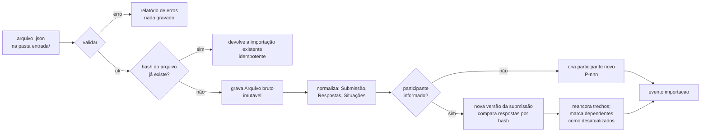
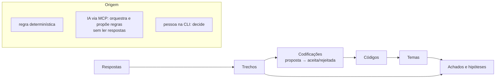
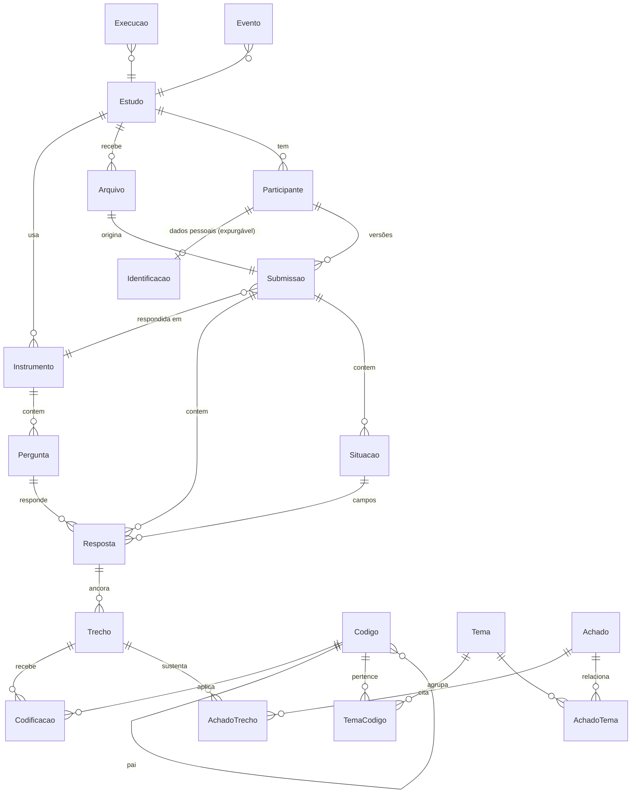
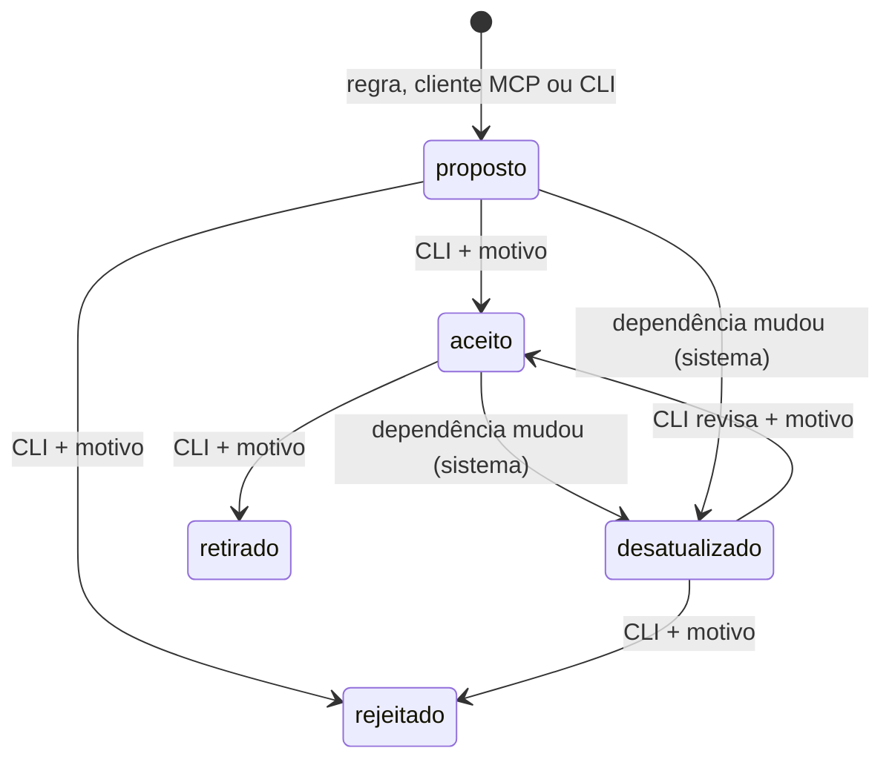

# Especificação técnica — backend local da pesquisa sobre acessibilidade em streaming

| Campo | Valor |
| :-- | :-- |
| Pedido | Issei, 30/10/2026 ("Especificação de backend local de pesquisa com integração MCP") |
| Projeto atendido | Liga Web Para Todos — pesquisa sobre acessibilidade em serviços de streaming de vídeo no Brasil |
| Fonte da coleta | Página `/entrevista-acessibilidade-streaming` do site (`issei/mauricio-site`, commit `1c05a19`), spec em `docs/specs/pages/entrevista-acessibilidade-streaming/SPEC.md` |
| Exemplo de dados | `anexos/exemplo-ficticio-v1.json` (fictício; SHA-256 `2afaf980…41e0b10`) |
| Estado | Proposta. Nada foi implementado. |
| Nome provisório | Núcleo genérico (pacote Python `caliope`, comando `caliope`) + pacote de estudo `estudos/streaming-2026/`. Repositório `issei/meikyu-caliope` (D-07) |
| Metacognição | [`05-metacognicao.md`](05-metacognicao.md): repositório, abstração e reaproveitamento do `knowledge-os` |

**Como ler.** Cada afirmação tem um destes rótulos quando a diferença importa:

- **[Recomendado]** — decisão que esta especificação propõe.
- **[Alternativa]** — opção válida, não escolhida, com o motivo.
- **[Validar]** — depende de teste técnico antes da implementação (lista em §19.3).
- **[Decisão do Issei]** — depende de uma escolha sua (lista em §19.4).

Siglas: MCP (Model Context Protocol), LLM (modelo de linguagem de grande porte), FTS5 (módulo de busca textual do SQLite), WAL (modo de diário do SQLite que permite ler enquanto outro processo escreve), LGPD (Lei Geral de Proteção de Dados, Lei 13.709/2018), CLI (interface de linha de comando). SHA-256 (função de hash usada para identificar conteúdo).

Prefixos dos identificadores deste documento: E (achado no exemplo), RF (requisito funcional), RNF (requisito não funcional), AN (análise), AVI (aviso de validação), R (risco), V (validação técnica), D (decisão pendente), P (premissa), M (fato verificado sobre o Minigraf, em `04-avaliacao-minigraf.md`).

---

## 1. Diagnóstico do problema e avaliação crítica da proposta

### 1.1 O problema real

A pesquisa é qualitativa. O volume esperado é pequeno: dezenas de entrevistas, cada uma com até 63 campos fixos e algumas situações. O valor está na **cadeia de interpretação**: trecho de resposta → código → tema → achado. Essa cadeia precisa ser rastreável, revisável e honesta sobre a origem de cada passo (regra, IA ou pessoa).

O desafio, portanto, **não é** volume, desempenho nem consulta de grafo profundo. O desafio é integridade, procedência e disciplina de estados.

### 1.2 O que os dados de exemplo mostram

Li o JSON fictício e o código da página (`src/js/entrevista/modelo.js`). Achados que mudam a especificação:

| # | Achado | Consequência |
| :-- | :-- | :-- |
| E-01 | `versao: 1` é a versão do **formato do arquivo**, não do questionário. | O JSON não diz qual texto de pergunta a pessoa leu. O backend precisa de um **instrumento versionado** (catálogo das perguntas) e deve ligar cada importação a uma versão dele. |
| E-02 | O JSON traz só os identificadores dos campos (`rotina-1`). O texto das perguntas está no HTML da página. | O instrumento deve ser extraído do HTML de um commit fixo, com o hash do HTML registrado. |
| E-03 | O JSON não tem identificador de participante nem de estudo. `antes-nome` é texto livre e pode ser fictício. | Duplicidade de **pessoa** não pode ser detectada com certeza. O sistema sugere; uma pessoa decide (§12.3). |
| E-04 | `atualizadoEm` muda a cada exportação. Dois arquivos da mesma pessoa diferem nesse campo mesmo sem mudança de resposta. | Duplicidade de **arquivo** deve usar o hash do conteúdo; mudança de **resposta** deve usar o hash de cada resposta, não a data. |
| E-05 | O arquivo contém dados de identificação (`antes-nome`, `aut-nome`, `aut-contato`) e dados sobre deficiência. | Dado pessoal sensível (LGPD, art. 5º, II, "dado referente à saúde") [Validar com quem responde pela pesquisa]. O backend deve separar identificação de conteúdo e permitir expurgo (§13.5). |
| E-06 | A autorização (Parte 9) vem no mesmo arquivo: `aut-uso`, `aut-identificacao`, `aut-revisao`. No exemplo, os três estão ausentes (ninguém marcou). | Ausência de autorização ≠ autorização. Um trecho só pode ficar "citável" se `aut-uso` for "Sim" ou "Sim, com as restrições…". |
| E-07 | Os campos de situação (`aparelho`, `servico`, `recurso`, `controle`) parecem categorias, mas são texto livre. | Contagem por aparelho exige uma **tabela de normalização versionada** ("Smart TV", "smart tv", "TV" → `smart_tv`). Valores sem mapeamento aparecem no relatório, nunca somem. |
| E-08 | As Partes 2 a 6 da página são os Eixos A a E do roteiro. | "JourneyStage" já existe no instrumento: é um atributo da pergunta, não uma entidade que alguém edita. |
| E-09 | O exemplo traz texto declarando "simulação" e "nome fictício". | Útil como verificação extra, mas a natureza dos dados (fictícia ou real) não pode depender de palavras no texto. Ela é declarada por uma pessoa e travada na base (§14.4). |

### 1.3 Avaliação crítica das decisões preliminares

| Decisão preliminar | Avaliação | Proposta |
| :-- | :-- | :-- |
| Só Windows | Python e SQLite são multiplataforma sem custo. Restringir o código não traz ganho. | **[Recomendado]** Windows é a única plataforma **suportada e testada** (CI em `windows-latest`). O código não usa nada específico de Windows, nem proíbe outro sistema. |
| Sem interface gráfica | Correto para o MVP. Mas a revisão humana precisa de um canal que **não seja o LLM** (ver linha "MCP como interface principal"). | **[Recomendado]** CLI mínima para as decisões humanas. |
| MCP como interface principal | Correto para consulta e proposta. **Pressuposto frágil:** o servidor não consegue distinguir uma decisão da pessoa de uma decisão do LLM, porque toda chamada chega pelo mesmo cliente. Se "aceitar código" estiver no MCP, o LLM pode aceitar sozinho. | **[Recomendado]** Pelo MCP, o cliente **consulta metadados e agregados, e propõe** (sem ler respostas, §8.3). Aceitar, rejeitar e concluir acontecem na CLI, no terminal da pessoa (ADR-ps-004). |
| Entrada e saída em JSON, sem CSV | Adequado. CSV pode ser gerado no notebook quando alguém precisar. | Manter. |
| Base de grafos (Minigraf) | O problema é um grafo pequeno, de profundidade fixa. O Minigraf 2.0.11 tem um defeito de integridade que atinge justamente relações com vários valores, e bloqueia a leitura por outro processo. | **[Recomendado]** SQLite. Minigraf fica como reavaliação futura (ver `04-avaliacao-minigraf.md`). |
| Python | Adequado: biblioteca padrão já tem SQLite, JSON e hash. Mesma linguagem do `knowledge-os`. | Manter. Python 3.12 ou superior [Validar versão na máquina]. |
| Notebook como complemento | Correto. Risco: o notebook virar o lugar onde a análise "de verdade" acontece. | Notebook só lê (conexão somente leitura). Toda análise que vira resultado é uma análise registrada no backend. |
| LLM opcional | Correto e central. | Nenhuma função do backend chama um LLM. **Decidido pelo Issei (30/10/2026): o LLM não processa o conteúdo das respostas; ele só orquestra a análise e o estudo.** O MCP aplica uma barreira de conteúdo (§8.3, ADR-ps-007). |

### 1.4 Pressupostos frágeis que encontrei

1. **"Respostas reais virão no mesmo formato."** O formato pode mudar (versão 2 do arquivo, nova pergunta). O backend deve recusar versão desconhecida com mensagem clara, e o instrumento deve ser versionado (E-01).
2. **"Uma pessoa = um arquivo."** A página permite exportar várias vezes. A mesma pessoa pode mandar dois arquivos com respostas diferentes (E-03, E-04).
3. **"Histórico imutável."** A autorização pode ser retirada a qualquer momento antes da publicação (texto da Parte 9 da página). Um histórico que nunca apaga nada entra em conflito com o direito de retirada e com a LGPD. O histórico deve ser imutável **exceto** por um expurgo registrado (§13.5).
4. **"Usar um LLM sobre os dados é neutro."** Se o cliente MCP usa um LLM em nuvem, as respostas saem da máquina. A autorização da página cobre uso na apuração e trechos na reportagem; ela não menciona processamento por IA de terceiros. **Resolvido (Issei, 30/10/2026):** o LLM não recebe o conteúdo das respostas; ele só orquestra. Esta especificação aplica a regra às bases fictícia e real, para que o teste com dados fictícios prove a mesma barreira que protegerá os dados reais.
5. **"Percentuais descrevem o estudo."** Com poucas entrevistas, percentuais enganam. As análises mostram contagem absoluta e o `n` sempre (§14.2).

---

## 2. Escopo e limites do produto

### 2.1 Dentro do escopo

- Validar, importar e preservar arquivos JSON exportados pela página.
- Manter o instrumento (perguntas) versionado.
- Normalizar respostas e situações para consulta.
- Registrar trechos (evidências), códigos, codificações, temas e achados, com estado e origem.
- Executar análises determinísticas registradas.
- Rastrear de achado a evidência e calcular impacto de mudanças.
- Exportar e restaurar o estado completo em JSON.
- Servidor MCP local (stdio) e CLI.

### 2.2 Fora do escopo

- Interface gráfica.
- Chamada a qualquer LLM pelo backend.
- Coleta de respostas (continua na página, no navegador da pessoa).
- Vários pesquisadores escrevendo ao mesmo tempo, rede, autenticação. O backend é **monousuário e local**.
- Estatística inferencial.
- Publicação de resultados.

### 2.3 Premissas

- P-1. Uma pessoa opera o backend numa máquina Windows.
- P-2. Volume: até 200 arquivos e 20.000 respostas. Acima disso, revisar RNF-02.
- P-3. Cada base guarda um estudo de uma natureza (fictícia ou real).

---

## 3. Arquitetura recomendada e justificativa

**[Recomendado]** Monólito modular em Python, com uma biblioteca de domínio e dois adaptadores finos (MCP e CLI) sobre ela. Um arquivo SQLite por base.

```
           ┌──────────────── Clientes ────────────────┐
           │ Cliente MCP (com ou sem LLM)   Terminal  │   Notebook (opcional)
           └──────┬──────────────────────────┬────────┘        │
                  │ stdio, JSON-RPC          │ comandos        │ só leitura
           ┌──────▼──────┐            ┌──────▼──────┐          │
           │ Adaptador   │            │ Adaptador   │          │
           │ MCP         │            │ CLI         │          │
           │ agregados/  │            │ ler texto/  │          │
           │ propor      │            │ decidir     │          │
           └──────┬──────┘            └──────┬──────┘          │
                  └────────────┬─────────────┘                 │
                        ┌──────▼───────────────────────┐       │
                        │ Núcleo de domínio (caliope)  │◄──────┘
                        │ importação · instrumento ·   │
                        │ trechos/códigos · estados ·  │
                        │ análises · rastreio/impacto ·│
                        │ exportação/restauração ·     │
                        │ eventos                      │
                        └──────┬───────────────────────┘
                        ┌──────▼──────┐   ┌────────────────┐
                        │ SQLite (WAL)│   │ Pastas         │
                        │ base.sqlite │   │ entrada/ saida/│
                        └─────────────┘   └────────────────┘
```

Justificativa:

1. **Regra no núcleo, não no adaptador.** MCP e CLI chamam as mesmas funções. As validações valem para os dois (exigência do pedido: o LLM não carrega regra de negócio).
2. **Um processo escreve, vários leem.** Com WAL, o servidor MCP, a CLI e o notebook leem ao mesmo tempo. A escrita é curta e serializada pelo SQLite.
3. **Sem dependência de terceiros no núcleo.** `sqlite3`, `json`, `hashlib`, `unicodedata` e `pathlib` são da biblioteca padrão. O `knowledge-os` mostrou que isso simplifica instalação e auditoria.
4. **Determinismo por construção.** Nenhuma função do núcleo usa relógio, aleatoriedade ou rede para produzir um resultado de análise. O relógio aparece só em metadados (data de execução), fora do hash do resultado.

**[Alternativa]** Serviço HTTP local com API REST e MCP sobre ele. Não escolhida: acrescenta porta de rede, processo permanente e superfície de ataque sem ganho para uma pessoa numa máquina.

---

## 4. Componentes e fluxo de dados

### 4.1 Componentes

| Componente | Responsabilidade | Não faz |
| :-- | :-- | :-- |
| `importacao` | Ler arquivo, validar (§12), calcular hashes, gravar bruto, normalizar, detectar duplicidade e mudança | Interpretar texto |
| `instrumento` | Carregar e versionar o catálogo de perguntas | Ler o site em tempo de execução |
| `analitico` | Trechos, códigos, codificações, temas, achados; transições de estado | Decidir sozinho |
| `analise` | Registro de análises determinísticas; execução; impressão digital das entradas | Chamar LLM |
| `rastreio` | Caminho achado ↔ evidência; impacto de mudanças; reancoragem de trechos | Alterar estado sem evento |
| `portabilidade` | Exportar e restaurar JSON canônico | Mesclar bases |
| `eventos` | Registro só de inclusão de toda mudança | — |
| `mcp` | Protocolo, esquemas, limites, barreira de conteúdo (§8.3) | Regra de negócio; devolver texto de resposta |
| `cli` | Comandos de operação e de decisão humana | Regra de negócio |

### 4.2 Fluxo de importação



### 4.3 Fluxo de análise e revisão



---

## 5. Modelo de domínio e relacionamentos

### 5.1 Revisão da lista de entidades sugerida

| Entidade sugerida | Decisão | Motivo |
| :-- | :-- | :-- |
| Study | **Manter** (`Estudo`) | Barato; guarda natureza e instrumento padrão. |
| — | **Criar** `Instrumento` e `Pergunta` | Ausente na lista. Sem ele, `rotina-1` não tem significado verificável (E-01). |
| SourceDocument | **Manter** (`Arquivo`) | Bytes originais, hash, data de recebimento. |
| Participant | **Manter** (`Participante`), com identificação separada (`Identificacao`) | Pseudônimo estável (`P-001`). Nome e contato ficam numa tabela que pode ser expurgada e nunca sai pelo MCP. |
| Response | **Renomear** para `Submissao` | Uma versão das respostas de um participante, vinda de um arquivo. |
| ResponseField | **Manter** (`Resposta`) | Uma resposta a uma pergunta, ou um campo de uma situação. |
| — | **Criar** `Situacao` | O formulário tem situações com 11 campos; elas são unidades de relato. |
| Evidence | **Manter** (`Trecho`) | Recorte ancorado numa resposta (posição inicial e final, texto citado, hash da resposta). |
| Code | **Manter** (`Codigo`), com hierarquia (`pai`) | A hierarquia substitui "Category". |
| Coding | **Manter** (`Codificacao`) | Liga trecho a código, com origem e estado. |
| Theme | **Manter** (`Tema`) + `TemaCodigo` | Tema agrupa códigos. |
| JourneyStage | **Eliminar como entidade** | É o eixo da pergunta no instrumento (E-08). |
| Finding | **Manter** (`Achado`) + `AchadoTrecho`, `AchadoTema` | Achado sempre cita evidência. |
| Hypothesis | **Fundir em Achado** (`tipo = hipotese`) | Mesma estrutura e ciclo de vida; muda o tipo. |
| AnalysisRun | **Manter** (`Execucao`) | Origem, critérios, versão, data, impressão digital das entradas. |
| Review | **Fundir em Evento** | Uma revisão é uma transição de estado com autor e justificativa. |
| ChangeRecord | **Manter** (`Evento`) | Registro só de inclusão. |

Resultado: menos conceitos para aprender (Category, JourneyStage, Hypothesis e Review deixam de ser entidades) e dois conceitos que faltavam (Instrumento, Situação).

### 5.2 Diagrama



### 5.3 Atributos essenciais

Campos comuns aos objetos analíticos (`Trecho`, `Codigo`, `Codificacao`, `Tema`, `Achado`):

| Campo | Valores | Regra |
| :-- | :-- | :-- |
| `origem` | `regra`, `cliente_mcp`, `humano_cli` | Imutável depois de criado. |
| `estado` | `proposto`, `aceito`, `rejeitado`, `desatualizado`, `retirado` | Transições na §13.3. |
| `criado_por` | Texto livre declarado (ex.: nome do cliente e do modelo que o cliente informou) | Declarado, não verificado. O backend registra como declarado. |
| `justificativa` | Texto | Obrigatório para `aceito` e `rejeitado`. |

Atributos específicos (resumo; o esquema SQL fica para a fase de implementação):

- `Estudo`: `id`, `nome`, `natureza` (`ficticio` | `real`, imutável), `criado_em`.
- `Instrumento`: `id` (ex.: `entrevista-streaming@1`), `fonte_commit`, `fonte_sha256` (do HTML), `sha256` (do catálogo).
- `Pergunta`: `instrumento_id`, `chave` (`rotina-1`), `parte`, `eixo` (`A`–`E` ou nulo), `tipo` (`texto` | `opcao` | `situacao_campo`), `rotulo`, `opcoes`, `sensivel` (identificação, contato), `ordem`.
- `Arquivo`: `id`, `sha256`, `bytes` (conteúdo original, sem alteração), `tamanho`, `recebido_em`, `nome_original`, `formato_versao`.
- `Participante`: `id` (`P-001`), `autorizacao_uso` (derivada da submissão vigente), `retirado_em`.
- `Identificacao`: `participante_id`, `nome`, `contato`, `forma_identificacao`. Fora do MCP.
- `Submissao`: `id`, `participante_id`, `arquivo_id`, `instrumento_id`, `versao` (1, 2, …), `vigente` (lógico), `atualizado_em_declarado`.
- `Resposta`: `id`, `submissao_id`, `pergunta_chave`, `situacao_id` (nulo para campo fixo), `texto_normalizado`, `sha256`, `vazia` (lógico).
- `Situacao`: `id`, `submissao_id`, `id_original`, `parte`, ordem.
- `Trecho`: `id`, `resposta_id`, `inicio`, `fim` (posições em caracteres do texto normalizado), `texto_citado`, `resposta_sha256`, `citavel` (derivado da autorização).
- `Codigo`: `id`, `rotulo`, `definicao`, `criterio_inclusao`, `criterio_exclusao`, `pai_id`, `versao`.
- `Codificacao`: `trecho_id`, `codigo_id`, `codigo_versao`.
- `Achado`: `id`, `tipo` (`achado` | `hipotese`), `enunciado`, `alcance` (ex.: "4 de 12 participantes").
- `Execucao`: `id`, `analise`, `analise_versao`, `parametros`, `impressao_entrada`, `resultado`, `resultado_sha256`, `natureza`, `executado_em`, `versao_pacote`.
- `Evento`: `id` (sequencial), `momento`, `ator` (`sistema` | `cliente_mcp` | `humano_cli`), `acao`, `objeto_tipo`, `objeto_id`, `antes`, `depois`, `justificativa`.

### 5.4 Pacote de estudo e costuras de abstração

O núcleo não conhece o formulário de streaming. Ele trabalha com termos genéricos; o estudo entra como **pacote de estudo** (análise em `05-metacognicao.md` §3; ADR-ps-009).

| Termo do núcleo | Neste estudo | Onde é declarado |
| :-- | :-- | :-- |
| Instrumento, pergunta, parte | Roteiro da entrevista, 63 perguntas, Partes 1 a 9 | `instrumento.json` |
| Dimensão (com valores) | Eixo, valores `A` a `E` (E-08) | `instrumento.json` |
| Grupo repetível (com campos) | Situação, 11 campos | `instrumento.json` |
| Item de grupo | Uma situação preenchida (entidade `Situacao` deste documento) | Dados importados |
| Regra de autorização | `aut-uso` com "Sim" ou "Sim, com as restrições…" | `instrumento.json` |
| Campos sensíveis | `antes-nome`, `aut-nome`, `aut-contato` | `instrumento.json` |
| Leitor de formato | JSON da página, formato versão 1 (`campos`, `situacoes`) | `leitores/pagina_v1.py` |
| Normalização | Aparelho, serviço, recurso e controle | `normalizacao.json` |
| Conjunto de análises | AN-01 a AN-05 com parâmetros deste estudo | `analises.json` |

Regras:

1. Só o leitor de formato conhece as chaves do arquivo de origem. Ele converte para uma representação interna (submissão, respostas por chave de pergunta, itens de grupo).
2. Nenhum arquivo do núcleo menciona chave, parte ou eixo do formulário de streaming (RNF-11).
3. A barreira de conteúdo (§8.3) e a natureza da base (§14.4) são **invariantes**: não viram configuração do pacote.
4. Fora do escopo até existir o caso: pesquisa sem perguntas fixas (transcrição livre) e vários estudos na mesma base.

Neste documento, `Situacao` e "eixo" continuam como nomes do estudo de streaming. No código, as tabelas usam `item_grupo` e `dimensao`.

### 5.5 Camadas de dados

| Camada | Tabelas | Regra |
| :-- | :-- | :-- |
| 0 — Bruto | `Arquivo` | Imutável. Só o expurgo (§13.5) remove. |
| 1 — Normalizado | `Submissao`, `Resposta`, `Situacao`, `Participante`, `Identificacao` | Derivado do bruto por função determinística. Pode ser reconstruído a partir da camada 0 e do instrumento. |
| 2 — Interpretação | `Trecho`, `Codigo`, `Codificacao`, `Tema`, `Achado` e ligações | Persistido. Não é derivável: é trabalho humano ou proposta. |
| 3 — Derivado | `Execucao` | Recalculável. Persistido para reprodutibilidade e auditoria. |
| Transversal | `Evento`, `Instrumento`, `Pergunta`, `Estudo` | — |

Resposta à questão 2 do pedido: **persistir** as camadas 0 e 2 (não deriváveis) e o registro de eventos; **materializar** a camada 1 para consulta (pode ser reconstruída); **persistir** a camada 3 só como registro de execução (o resultado pode ser recalculado e comparado pelo hash).

---

## 6. Estratégia de armazenamento e comparação de tecnologias

| Critério | Arquivos JSON + Git | **SQLite (biblioteca padrão)** | DuckDB | Minigraf 2.0.11 | PostgreSQL |
| :-- | :-- | :-- | :-- | :-- | :-- |
| Adequação ao domínio | Fraca: sem relação nem consulta | Boa: tabelas e chaves | Boa para análise, fraca para muitas escritas pequenas | Boa em tese; quebra em relação com vários valores (M-07) | Boa |
| Rastreabilidade | Manual | Chaves estrangeiras; junções; CTE recursiva | Junções | Datalog | Igual ao SQLite |
| Consultas e filtros | Código próprio | SQL + FTS5 [Validar FTS5 no Python do Windows] | SQL analítico forte | Datalog, sem busca textual | SQL + busca textual |
| Integridade | Nenhuma | Esquema, `FOREIGN KEY`, `UNIQUE`, `CHECK`, gatilhos | Esquema; restrições mais limitadas | Nenhum esquema | Completa |
| Transações e concorrência | Nenhuma | ACID; WAL: um escritor, vários leitores em processos diferentes | Um processo escreve | Um processo por arquivo, inclusive para ler (M-09) | Completa |
| Histórico | Git | Tabela de eventos (projeto) | Tabela de eventos | Bitemporal nativo | Tabela de eventos |
| Cópia e restauração | Git | Cópia do arquivo; API `backup`; exportação JSON (projeto) | Cópia; exportação | Cópia do arquivo | `pg_dump` |
| Windows | Sim | Sim (embutido no Python) | Sim (roda pronta) | Sim (nível 1) | Exige serviço instalado |
| Python | Nativo | Nativo | Pacote externo | Pacote externo; API mínima (M-05) | Driver externo |
| Operação | Mínima | Mínima | Baixa | Baixa | Alta: desproporcional |
| Maturidade | — | Décadas | Alta | Nove meses (M-01) | Décadas |

**[Recomendado]** SQLite em modo WAL, com `PRAGMA foreign_keys = ON`, `PRAGMA journal_mode = WAL`, e transações explícitas em toda escrita. FTS5 para busca textual nas respostas [Validar]. Colunas JSON (`antes`, `depois`, `parametros`, `resultado`) com a extensão JSON do SQLite.

**[Alternativa]** DuckDB como ferramenta de análise no notebook, lendo a exportação JSON. Não é necessário no MVP.

**[Validar]** O banco não deve ficar numa pasta sincronizada (OneDrive, Google Drive). A sincronização pode copiar o arquivo no meio de uma escrita. Pasta padrão: `%LOCALAPPDATA%\pesquisa-streaming\`.

---

## 7. Avaliação técnica do Minigraf

Detalhe e evidências em [`04-avaliacao-minigraf.md`](04-avaliacao-minigraf.md). Resumo:

- **Pontos fortes:** arquivo único; histórico bitemporal nativo; Python e Windows em nível 1, com roda `win_amd64` no PyPI.
- **Impeditivos para o MVP:**
  1. Defeito #371: valores múltiplos do mesmo atributo, gravados juntos, voltam como um valor. Reproduzi na 2.0.11: a mesma consulta deu 1 valor antes de reabrir o arquivo e 3 valores depois. Codificação é exatamente esse caso.
  2. A API Python não tem transação com vários comandos. A solução de contorno do #371 (um comando por valor) quebra a atomicidade da importação.
  3. Bloqueio por processo: com o servidor MCP aberto, nem o notebook nem a CLI conseguem ler a base.
  4. Projeto com nove meses, um autor declarado, mudança de formato prevista para a v3.
- **Veredito:** não usar no MVP. Reavaliar depois da v3.0.0, como projeção derivada da exportação JSON, se surgir necessidade real.

---

## 8. Arquitetura do servidor MCP

**[Recomendado]** Mesmo padrão do servidor do `knowledge-os` (BL-20), que já funciona:

1. Transporte stdio, local. Sem porta de rede.
2. JSON-RPC 2.0, uma mensagem por linha; só protocolo em `stdout`; diagnóstico em `stderr`.
3. Implementação com a biblioteca padrão. O SDK oficial `mcp` traria dezenas de dependências (verificado pelo `knowledge-os` no PyPI, versão 2.3.0) para um protocolo de poucas mensagens. **[Alternativa]** Usar o SDK se for preciso transporte HTTP ou recursos avançados do protocolo. Ponto de partida: cópia de `src/kos/mcp/__init__.py` do `knowledge-os` (ADR-ps-008). Lá não há `resources` nem `outputSchema`: os dois são acréscimos deste projeto.
4. Entrada e saída em UTF-8 explícito (`sys.stdin.reconfigure(encoding="utf-8")`). No Windows, o padrão do console pode ser outra codificação [Validar].
5. Versões do protocolo aceitas: as mesmas do `knowledge-os` (`2025-06-18`, `2025-03-26`, `2024-11-05`), mais a versão vigente na data da implementação [Validar].
6. Capacidades anunciadas: `tools` e `resources`.
7. Todo resultado tem `content` (texto) e `structuredContent` (JSON), com `outputSchema` declarado.
8. Nenhum resultado contém texto de participante (§8.3).
9. Todo resultado traz `natureza` (`ficticio` | `real`). Se `ficticio`, o texto começa com **"DADOS FICTÍCIOS — resultado demonstrativo, não é evidência de pesquisa."**
10. Toda chamada de ferramenta grava uma linha em `ChamadaMcp` (ferramenta, hash dos argumentos, resultado, duração). Argumentos com texto de participante não são gravados por extenso.

### 8.1 Recursos (Resources) e ferramentas (Tools)

O pedido separa leitura (recursos) de operação (ferramentas). Essa separação é boa, mas o suporte a recursos varia entre clientes MCP [Validar nos clientes que serão usados]. Alguns clientes só usam ferramentas.

**[Recomendado]** Todo recurso tem uma ferramenta de leitura equivalente, que chama a mesma função. Assim, qualquer cliente MCP consegue usar o backend (questão 7 do pedido).

### 8.2 O que o MCP não faz

| Operação | Onde fica | Motivo |
| :-- | :-- | :-- |
| Aceitar, rejeitar, retirar | CLI | O servidor não distingue pessoa de LLM (ADR-ps-004). |
| Restaurar uma base | CLI | Substituir a base com o servidor aberto é arriscado. O MCP oferece só a verificação prévia. |
| Expurgar participante | CLI | Ação irreversível. |
| Ler identificação (nome, contato) | CLI | Dado pessoal fora do alcance do LLM. |
| Ler texto de resposta, situação ou trecho | CLI e notebook | Barreira de conteúdo (§8.3). |
| Criar trecho por posição | CLI | Escolher um recorte exige ler o texto. |
| Ler arquivo por caminho livre | Nenhum | Só nomes de arquivo dentro de `entrada/`. |

**[Alternativa]** Expor `decidir_*` pelo MCP com confirmação do usuário via *elicitation* do protocolo, desligado por padrão. Só faz sentido se os clientes usados suportarem esse recurso [Validar].

### 8.3 Barreira de conteúdo

Decisão do Issei (30/10/2026): o LLM não processa o conteúdo das respostas; ele só orquestra a análise e o estudo.

**O que o MCP pode devolver:**

- estrutura: estudo, instrumento (texto das perguntas), partes, eixos;
- identificadores, estados, origens, versões, hashes e datas;
- metadados de resposta: pergunta, eixo, preenchida ou vazia, tamanho em caracteres;
- valores de opção fixos do formulário (ex.: `aut-uso`), porque não são texto livre;
- livro de códigos, regras de codificação, temas e hipóteses criados pelo próprio MCP;
- resultados de análise **agregados** (contagens, matrizes, listas de ids);
- eventos sem antes e depois.

**O que o MCP nunca devolve:**

- texto de resposta, de campo de situação ou de trecho, inteiro ou em parte (resumo, destaque de busca, palavra vizinha);
- valores de campos de situação (`aparelho`, `servico` e outros, que são texto livre; E-07);
- identificação;
- texto livre gravado pela CLI (nota, justificativa, enunciado), salvo se a pessoa marcar `--visivel-mcp` ao gravar.

**Como a regra é garantida:**

1. As funções de leitura do MCP usam **projeções próprias** (consultas que não selecionam colunas de texto). Elas não filtram depois de ler.
2. Mensagens de erro e avisos citam chave e posição, nunca o valor.
3. **Teste de vazamento** (RF-24): para cada resposta das fixtures, nenhuma sequência de 20 ou mais caracteres aparece em nenhuma saída do MCP, inclusive erros, recursos e eventos.
4. A importação pelo MCP aceita só **nome de arquivo** em `entrada/`. O conteúdo do arquivo não passa pelo cliente.

**Limite da barreira:** ela vale para este servidor. Se o mesmo cliente MCP tiver outro servidor com acesso a arquivos (por exemplo, um servidor de sistema de arquivos), esse outro servidor pode ler a base e as exportações. A pasta de dados não deve estar ao alcance de nenhum outro servidor do cliente (R-11).

---

## 9. Catálogo inicial de recursos e ferramentas

Contratos completos em [`02-contratos-mcp.md`](02-contratos-mcp.md).

### 9.1 Recursos

| URI | Conteúdo | Ferramenta equivalente |
| :-- | :-- | :-- |
| `pesquisa://estudo` | Estudo, natureza, contagens, instrumento vigente | `estudo_resumo` |
| `pesquisa://instrumento/{id}` | Perguntas, partes, eixos | `instrumento_obter` |
| `pesquisa://participantes` | Pseudônimos, autorização, submissão vigente | `participantes_listar` |
| `pesquisa://submissoes/{id}` | Metadados das respostas e situações, sem texto | `respostas_consultar` |
| `pesquisa://codigos` | Livro de códigos com estados | `codigos_listar` |
| `pesquisa://temas` | Temas e códigos | `temas_listar` |
| `pesquisa://achados` | Achados e hipóteses, com ids das evidências | `achados_consultar` |
| `pesquisa://analises` | Análises disponíveis e execuções | `analises_listar` |
| `pesquisa://eventos` | Últimos eventos | `eventos_listar` |

### 9.2 Ferramentas

| Ferramenta | Tipo | Incremento |
| :-- | :-- | :-- |
| `estudo_resumo`, `instrumento_obter`, `participantes_listar` | leitura | MVP |
| `json_validar` | leitura (não grava) | MVP |
| `json_importar` | escrita idempotente | MVP |
| `respostas_consultar`, `respostas_buscar` (só metadados e contagens) | leitura | MVP |
| `trechos_consultar` (só metadados) | leitura | MVP |
| `analises_listar`, `analise_executar` | leitura / escrita idempotente | MVP |
| `exportar`, `restauracao_verificar` | escrita em `saida/` / leitura | MVP |
| `eventos_listar` | leitura | MVP |
| `codigo_propor`, `codigos_listar` | escrita idempotente / leitura | I2 |
| `regra_propor`, `regra_aplicar`, `regras_listar` (codificação por regra determinística) | escrita idempotente / leitura | I2 |
| `tema_propor`, `tema_vincular_codigo`, `temas_listar` | escrita / leitura | I3 |
| `achado_propor`, `achados_consultar` | escrita / leitura | I3 |
| `rastrear`, `impacto` | leitura | I3 |

Não há ferramenta genérica do tipo "executar SQL" ou "atualizar objeto". Cada ferramenta faz uma operação do domínio, com validação própria (pedido, §7).

---

## 10. Contratos de entrada e saída

Ver [`02-contratos-mcp.md`](02-contratos-mcp.md): envelope comum, catálogo de erros, regras de idempotência, limites e o contrato de cada ferramenta.

---

## 11. Requisitos funcionais e não funcionais

Prioridade: **MVP** (necessário para a demonstração da §13 do pedido), **I2**, **I3** (incrementos seguintes).

### 11.1 Requisitos funcionais

| ID | Requisito | Justificativa | Critério de aceitação | Prior. |
| :-- | :-- | :-- | :-- | :-- |
| RF-01 | O sistema deve criar uma base com estudo, natureza (`ficticio` ou `real`) e instrumento. A natureza não tem valor padrão e não muda depois. | Impedir mistura de fictício e real (questão 9). | `caliope iniciar` sem `--natureza` falha com erro `CFG-001`. Nenhum comando altera a natureza. | MVP |
| RF-02 | O sistema deve carregar o instrumento a partir de um catálogo JSON com hash e commit de origem. | E-01, E-02. | O catálogo `entrevista-streaming@1` tem 63 chaves fixas, 11 campos de situação e 5 eixos; o teste compara com o HTML do commit `1c05a19`. | MVP |
| RF-03 | O sistema deve validar um JSON sem gravar nada e devolver todos os erros e avisos encontrados. | Feedback antes de importar. | `json_validar` com o exemplo devolve `valido = true`, 0 erros e os avisos AVI-001 (autorização ausente) e AVI-004 (texto que menciona simulação). | MVP |
| RF-04 | O sistema deve importar um JSON válido numa transação: tudo ou nada. | Integridade. | Falha simulada no meio da importação deixa a base igual à anterior (teste). | MVP |
| RF-05 | O sistema deve guardar os bytes originais do arquivo, sem alteração, com SHA-256. | Preservação da fonte. | Exportar o bruto e calcular o SHA-256 dá o mesmo valor do recebimento. | MVP |
| RF-06 | Importar o mesmo arquivo (mesmo SHA-256) de novo não deve criar nada e deve devolver a importação existente. | Idempotência (questão 4). | Duas importações do exemplo → 1 arquivo, 1 submissão, `duplicado = true` na segunda. | MVP |
| RF-07 | O sistema deve normalizar respostas: Unicode NFC, quebras de linha `\n`, sem espaço no início e no fim. O texto bruto continua no `Arquivo`. | A mesma resposta sempre produz o mesmo hash e as mesmas posições de trecho. | Resposta com `\r\n` e com caracteres decompostos produz o mesmo `sha256` que a forma normalizada. | MVP |
| RF-08 | Ao importar um arquivo novo para um participante existente, o sistema deve criar uma nova versão da submissão e listar as respostas incluídas, alteradas e removidas. | Questão 5. | Exemplo com 1 resposta alterada → relatório com exatamente 1 alteração e versão 2 vigente. | MVP |
| RF-09 | O sistema deve consultar respostas por participante, pergunta, parte, eixo e texto. | Consulta via MCP. | Consulta por eixo `A` no exemplo devolve as 5 respostas `escolha-*` e a situação da parte A. | MVP |
| RF-10 | A pessoa deve criar trechos ancorados (resposta, início, fim, texto citado, hash da resposta) pela CLI. O texto citado deve ser igual ao recorte. | Rastreabilidade (questão 6). | Trecho com posições que não correspondem ao texto citado é recusado (`TRC-002`). | MVP |
| RF-11 | Um trecho só é `citavel = true` se a autorização vigente do participante for "Sim" ou "Sim, com as restrições…", e o participante não tiver sido retirado. | E-06. | No exemplo (autorização ausente), todo trecho tem `citavel = false`. | MVP |
| RF-12 | O sistema deve executar as análises determinísticas da §14.2 e registrar a execução. | Reprodutibilidade. | Duas execuções com a mesma entrada produzem o mesmo `resultado_sha256`. | MVP |
| RF-13 | Todo resultado de análise sobre base fictícia deve trazer `natureza = ficticio` e o aviso de demonstração. | Questões 9 e 12. | Teste em todas as análises. | MVP |
| RF-14 | O sistema deve exportar o estado completo em JSON canônico e restaurá-lo numa base vazia. | Portabilidade. | Exportar → restaurar → exportar produz arquivos idênticos byte a byte. | MVP |
| RF-15 | O sistema deve gravar um evento para toda mudança de estado, com ator, ação, antes, depois e justificativa. | Histórico. | Nenhuma escrita sem evento (teste que compara contagens). | MVP |
| RF-16 | O sistema deve recusar entrada inválida com código de erro, campo e ação sugerida. | Tratamento de erros. | Todos os códigos do catálogo de erros têm teste. | MVP |
| RF-17 | O cliente MCP deve poder propor códigos e regras de codificação (termos, perguntas, eixos). O backend aplica a regra e cria codificações `propostas`, com `origem = regra`. | O LLM orquestra sem ler respostas. | Nenhuma ferramenta MCP produz estado `aceito`; o resultado de `regra_aplicar` só tem contagens e ids. | I2 |
| RF-18 | A pessoa deve aceitar, rejeitar ou retirar objetos pela CLI, com justificativa obrigatória. | Decisão humana. | `caliope revisar … --aceitar` sem `--motivo` falha. | I2 |
| RF-19 | O sistema deve manter versões das definições de código; uma codificação guarda a versão do código aplicada. | Mudança de critério. | Mudar a definição marca as codificações da versão anterior para revisão. | I2 |
| RF-20 | O sistema deve aceitar propostas de temas e de hipóteses baseadas em resultados agregados. Um achado só passa a `aceito` com pelo menos um trecho aceito, ligado pela pessoa na CLI. | Rastreabilidade sem expor texto ao LLM. | `achado_propor` sem execução nem tema de base → `ACH-001`; `caliope revisar ACH-… --aceitar` sem trecho → `ACH-002`. | I3 |
| RF-21 | O sistema deve rastrear um achado até as respostas de origem e uma resposta até os achados que dependem dela. | Questão 6. | Teste com cadeia completa no exemplo fictício. | I3 |
| RF-22 | O sistema deve calcular o impacto de uma mudança: objetos e execuções afetados. | Questão 5; princípio "identificar resultados afetados". | Alterar uma resposta marca trechos, codificações, achados e execuções dependentes como `desatualizado`. | I3 |
| RF-24 | Nenhuma saída do MCP deve conter texto de resposta, de situação, de trecho ou de identificação (§8.3). | Decisão do Issei (30/10/2026). | Teste de vazamento: nenhuma sequência de 20 ou mais caracteres de qualquer resposta das fixtures aparece em saída do MCP. | MVP |
| RF-25 | O sistema deve carregar um estudo a partir de um pacote de estudo (instrumento, normalização, leitor de formato, conjunto de análises), sem mudar o núcleo. | Reuso em outras pesquisas (§5.4). | Um pacote de teste com instrumento diferente (2 perguntas, 1 grupo com 2 campos, 1 dimensão) importa, consulta e executa AN-01 sem mudança no núcleo. | MVP |
| RF-23 | A pessoa deve poder expurgar os dados de um participante pela CLI. | Retirada de autorização; LGPD. | Depois do expurgo, nenhum texto do participante existe na base nem na exportação; o evento registra o expurgo sem o conteúdo. | I2 |

### 11.2 Requisitos não funcionais

| ID | Requisito | Critério de aceitação | Prior. |
| :-- | :-- | :-- | :-- |
| RNF-01 | Plataforma: Windows 10 ou 11, x64, NTFS local, Python ≥ 3.12. | CI em `windows-latest` passa todos os testes. | MVP |
| RNF-02 | Desempenho proporcional: com 200 arquivos, toda ferramenta responde em menos de 2 s. | Teste de carga com dados fictícios gerados. | MVP |
| RNF-03 | Instalação: um comando dentro de um ambiente virtual; nenhuma dependência de execução fora da biblioteca padrão no núcleo. | `pip install .` numa máquina limpa; `caliope --versao` funciona. | MVP |
| RNF-04 | Confiabilidade: toda escrita numa transação; a base sobrevive a encerramento abrupto. | Teste que mata o processo durante a importação; `PRAGMA integrity_check` = `ok`. | MVP |
| RNF-05 | Segurança local: sem porta de rede; sem leitura de caminho livre; nem identificação nem texto de resposta saem pelo MCP. | Testes de caminho (`..`, caminho absoluto, unidade `C:`) e de ausência de nome/contato nas saídas MCP. | MVP |
| RNF-06 | Determinismo: análise e exportação não dependem de relógio, ordem de inserção nem configuração regional. | Mesmo hash em duas máquinas e em duas execuções. | MVP |
| RNF-07 | Observabilidade: log em `stderr` e em arquivo (linhas JSON); registro `ChamadaMcp`; comando `caliope diagnostico`. | `caliope diagnostico` mostra versão, caminho da base, natureza, contagens, integridade. | MVP |
| RNF-08 | Manutenibilidade: núcleo sem dependência de adaptador; cobertura de testes ≥ 85 % no núcleo. | Relatório de cobertura no CI. | MVP |
| RNF-09 | Texto: UTF-8 em todo arquivo e em stdio, inclusive no console do Windows. | Teste com acentos e emoji passando pelo servidor MCP em subprocesso. | MVP |
| RNF-10 | Proteção de dados: base real fora de pasta sincronizada; aviso se estiver. | `caliope diagnostico` avisa se o caminho contém `OneDrive`. | MVP |
| RNF-11 | Fronteira núcleo × estudo: o núcleo não depende de nada do estudo de streaming. | Teste de fronteira: nenhum arquivo em `src/caliope/` contém `rotina-` nem `aut-uso`, nem as palavras inteiras `eixo` e `situacao` (expressão regular com limite de palavra, para não casar com "deixou"). | MVP |

---

## 12. Importação, validação e exportação JSON

### 12.1 Validação (ordem fixa; acumula erros, não para no primeiro)

| # | Regra | Erro |
| :-- | :-- | :-- |
| 1 | Tamanho ≤ 1 MiB | `VAL-001` |
| 2 | UTF-8 válido; JSON válido | `VAL-002` |
| 3 | Raiz é objeto com `versao`, `campos`, `situacoes`; `atualizadoEm` opcional | `VAL-003` |
| 4 | `versao` é um formato conhecido (hoje: `1`) | `VAL-004` |
| 5 | Chave de campo casa `^[a-z0-9-]{1,64}$` (mesma regra da página) | `VAL-005` |
| 6 | Chave de campo existe no instrumento | `VAL-006` (erro; ver nota) |
| 7 | Valor de campo é texto | `VAL-007` |
| 8 | Campo de opção tem um valor da lista do instrumento | `VAL-008` |
| 9 | Situação: `parte` em `A`–`E`; só campos do instrumento; valores texto | `VAL-009` |
| 10 | `atualizadoEm`, se existir, é data ISO-8601 | `VAL-010` |

Nota sobre a regra 6: a página **descarta** chaves desconhecidas ao importar. O backend **recusa**, porque descartar em silêncio perderia dado de pesquisa. **[Alternativa]** Aceitar e guardar como "campo não catalogado", com aviso. Decido por recusar no MVP porque o instrumento é fixo.

Avisos (não impedem importação):

| Código | Situação |
| :-- | :-- |
| `AVI-001` | Autorização de uso ausente: trechos não serão citáveis. |
| `AVI-002` | Nenhuma resposta preenchida. |
| `AVI-003` | Possível mesmo participante de outra submissão (nome igual após normalização, ou ≥ 80 % das respostas iguais por hash). |
| `AVI-004` | Texto menciona "fictício", "simulação" ou "ilustrativo" e a base é `real`; ou a base é `ficticio` (aviso informativo). |
| `AVI-005` | Situação sem nenhum campo preenchido (será ignorada na contagem). |

### 12.2 Importação

1. Ler o arquivo de `entrada/` por nome. Pela CLI, também por caminho. O MCP não recebe o conteúdo do arquivo (§8.3).
2. Validar (§12.1). Erro → devolve o relatório; nada é gravado.
3. Calcular o SHA-256 dos **bytes**. Já existe → devolve a importação existente (`duplicado = true`).
4. O leitor de formato do pacote converte o arquivo para a representação interna (§5.4).
5. Abrir transação. Gravar `Arquivo`. Resolver participante (§12.3). Gravar `Submissao`, `Resposta`, `Situacao`. Atualizar a autorização vigente. Comparar com a versão anterior. Reancorar trechos (§13.4). Gravar eventos. Confirmar a transação.
6. Devolver: ids criados, contagens, diferenças, avisos.

### 12.3 Duplicidade e identidade do participante

| Caso | Detecção | Ação |
| :-- | :-- | :-- |
| Mesmo arquivo | SHA-256 dos bytes | Nada; devolve a importação existente. |
| Mesma pessoa, arquivo novo | Não é detectável com certeza (E-03) | Quem importa informa `participante = "P-003"`. Sem isso, o sistema cria participante novo e emite `AVI-003` se houver candidato. |
| Associação errada | — | Pela CLI: `caliope participante mover S-0007 --para P-004 --motivo …` (evento). |

### 12.4 Exportação

Um arquivo JSON canônico (chaves ordenadas, UTF-8, sem espaços extras, listas ordenadas por id):

```json
{
  "formato": "pesquisa-streaming/exportacao",
  "formato_versao": 1,
  "pacote_versao": "0.1.0",
  "estudo": { "id": "…", "natureza": "ficticio" },
  "esquema_versao": 1,
  "inclui_identificacao": false,
  "tabelas": { "arquivo": [ … ], "submissao": [ … ], "…": [ … ] },
  "sha256_tabelas": "…"
}
```

- `Arquivo.bytes` vai como texto (o original é JSON UTF-8), com o SHA-256 para conferência.
- Por padrão, a exportação **não** inclui `Identificacao`. Incluir exige `--com-identificacao` na CLI. O MCP não oferece essa opção.
- O arquivo é gravado em `saida/` com nome `exportacao-<estudo>-<evento>.json`. O número do último evento torna o nome determinístico.

### 12.5 Restauração

1. `restauracao_verificar` (MCP e CLI): confere formato, versões, hashes e integridade referencial. Não grava.
2. `caliope restaurar <arquivo> --base <caminho-novo>` (só CLI): cria uma base **nova**. Nunca sobrescreve uma base existente. Não há mescla no MVP.
3. Critério: exportar a base restaurada produz um arquivo idêntico ao original.

---

## 13. Histórico, versionamento e rastreabilidade

### 13.1 Registro de eventos

- Tabela `Evento` só de inclusão. Gatilhos SQL recusam `UPDATE` e `DELETE` (exceto o expurgo, §13.5).
- Toda função do núcleo que escreve grava o evento na **mesma transação**.
- O estado atual dos objetos fica nas tabelas; o evento guarda o antes e o depois. Não há reconstrução por eventos (*event sourcing*): é mais simples e suficiente. **[Alternativa]** Reconstrução completa por eventos; não escolhida porque exige mais código e não responde a nenhuma questão do pedido que a tabela atual não responda.

### 13.2 Versionamento

| Objeto | Como versiona |
| :-- | :-- |
| Instrumento | Id com versão (`entrevista-streaming@1`). Novo HTML com mudança de pergunta → novo instrumento. |
| Submissão | Número de versão por participante; só uma vigente. |
| Código | `versao` sobe quando definição ou critérios mudam. Codificação guarda a versão usada. |
| Análise | `analise_versao` no código; muda quando a lógica muda. |
| Esquema da base | `PRAGMA user_version`; migrações numeradas. |
| Formato de exportação | `formato_versao`. |

### 13.3 Estados e transições



Regras:

- Uma sugestão de IA nunca altera um objeto `aceito`. Ela cria outro objeto `proposto`, que pode coexistir (contestação).
- `rejeitado` e `retirado` continuam na base e na exportação.
- Só o ator `sistema` produz `desatualizado`.

### 13.4 Reancoragem de trechos

Quando a resposta de um trecho muda (nova versão da submissão):

1. Se o texto citado aparece **exatamente uma vez** no texto novo → o trecho é reancorado nas novas posições; evento `reancorado`; estado mantido.
2. Caso contrário → o trecho fica `desatualizado`; os dependentes também (§13.6).

### 13.5 Expurgo

Exceção controlada à imutabilidade, só pela CLI, com confirmação digitada:

- Apaga `Identificacao`, os bytes do `Arquivo` e os textos de `Resposta` e `Trecho` do participante.
- Mantém ids e estrutura, com o texto substituído por `[expurgado]`, para que contagens antigas continuem explicáveis.
- Grava evento `expurgo` sem conteúdo pessoal.
- Exportações anteriores continuam com o dado: o relatório do expurgo lista os arquivos em `saida/` gerados antes dele.

### 13.6 Rastreio e impacto

- **Rastreio (para trás):** achado → trechos (direto) e temas → códigos → codificações → trechos → resposta → submissão → arquivo. Consulta SQL com junções; profundidade fixa.
- **Impacto (para frente):** dado um objeto alterado, listar os dependentes. Mesmas junções, na direção oposta.
- **Execuções:** cada `Execucao` guarda a impressão digital das entradas (SHA-256 da lista ordenada de `(id, sha256)` dos objetos lidos). Uma execução está `desatualizada` quando a impressão atual difere da guardada. Não é preciso grafo de dependências explícito.

---

## 14. Análises determinísticas e assistidas por IA

### 14.1 Três categorias, três caminhos

| Categoria | Quem executa | Onde | Estado do resultado |
| :-- | :-- | :-- | :-- |
| Determinística | Núcleo do backend | `analise_executar` / `caliope analisar` | Registrado em `Execucao`; reproduzível por hash |
| Orquestração por IA | O LLM do cliente MCP, **sem ler respostas** | Escolhe e executa análises, propõe códigos, regras, temas e hipóteses | `proposto`; codificações com `origem = regra` |
| Interpretação humana | A pessoa | CLI (`caliope revisar`) | `aceito` / `rejeitado` / `retirado`, com motivo |

### 14.2 Análises determinísticas do MVP

| ID | Análise | Saída |
| :-- | :-- | :-- |
| AN-01 | Cobertura do instrumento: por pergunta, quantos participantes responderam, deixaram em branco ou não tiveram o campo | Tabela pergunta × contagem; `n` |
| AN-02 | Situações por parte (eixo) e por participante | Contagens |
| AN-03 | Situações por aparelho, serviço, recurso e controle, com a tabela de normalização versionada (E-07) | Contagens; quantidade de valores sem mapeamento (a lista dos valores só na CLI) |
| AN-04 | Autorização: participantes por resposta de `aut-uso`, incluindo "ausente" | Contagens |
| AN-05 | Busca textual com critério explícito (termos, operadores) | Contagem por pergunta, eixo e participante e lista de ids, ordenada por id; sem texto |
| AN-06 (I2) | Frequência de códigos aceitos: por participante (conta pessoas, não ocorrências), por eixo, por pergunta | Contagens |
| AN-07 (I2) | Coocorrência de códigos aceitos no mesmo participante | Matriz |
| AN-08 (I3) | Qualidade: achados sem trecho aceito, códigos sem codificação, trechos desatualizados | Lista de pendências |

Regras de saída:

- Contagem absoluta e `n` sempre. Percentual só com o denominador ao lado ("3 de 12").
- Ordenação total e explícita (por id) em toda lista.
- Resultado em JSON canônico; `resultado_sha256` sobre esse JSON, sem a data.
- Cabeçalho: análise, versão, parâmetros, impressão das entradas, natureza, data, versão do pacote.

### 14.3 Como a IA orquestra sem ler respostas

O LLM trabalha com a estrutura do estudo e com resultados agregados. Exemplos do que ele faz:

1. Planejar a análise a partir do instrumento: quais eixos cruzar, quais análises executar e em que ordem.
2. Executar análises determinísticas e ler os agregados (contagens, matrizes, cobertura).
3. Propor o livro de códigos a partir das perguntas, dos eixos e das questões de pesquisa.
4. Propor **regras de codificação** determinísticas: código, termos, modo (`qualquer` ou `todos`), perguntas e eixos. O backend aplica a regra: cada frase de resposta que casa vira um trecho e uma codificação `proposta`, com `origem = regra`.
5. Acompanhar a revisão humana: quantas propostas de cada regra a pessoa aceitou ou rejeitou. Com isso, ajustar a regra (nova versão) sem ver o texto.
6. Propor temas (agrupamento de códigos) e hipóteses baseadas em execuções e temas.
7. Listar pendências: trechos desatualizados, achados sem evidência, perguntas pouco respondidas.

O que fica com a pessoa, na CLI ou no notebook: ler respostas, criar trechos por posição, revisar propostas, ligar evidências a achados e concluir.

- O campo `criado_por` guarda o que o cliente declarar (ex.: "Claude Desktop / modelo X"). O backend não verifica.
- Frase, para a regra: trecho entre o início do texto, `.`, `!`, `?` ou quebra de linha. A divisão é determinística e versionada com a regra.
- **[Alternativa]** O backend chamar um LLM diretamente. Não escolhida: cria dependência e custo, e contraria a decisão do Issei.

### 14.4 Fictício × real

1. Natureza fixada na criação da base (RF-01). Uma base nunca mistura as duas.
2. Toda saída MCP e toda exportação levam `natureza`.
3. Base fictícia: aviso fixo no início de todo texto de resultado.
4. Recomendação de operação: duas bases separadas, `demo.sqlite` e `pesquisa.sqlite`, em pastas separadas. O servidor MCP de cada uma aparece no cliente com nome diferente (`pesquisa-demo`, `pesquisa-real`).

---

## 15. Estrutura de diretórios e organização do código

```
meikyu-caliope/
├── pyproject.toml
├── README.md
├── docs/
│   ├── especificacao/        (estes documentos)
│   └── adr/                  (ADR-ps-001 …)
├── estudos/
│   └── streaming-2026/                 (pacote de estudo, §5.4)
│       ├── instrumento.json            (entrevista-streaming@1)
│       ├── normalizacao.json
│       ├── analises.json
│       └── extrair_instrumento.py      (lê o HTML do site num commit fixo)
├── src/caliope/
│   ├── __init__.py  __main__.py  erros.py  config.py
│   ├── base/        schema.sql  migracoes/  conexao.py
│   ├── instrumento/ carregar.py
│   ├── importacao/  validar.py  normalizar.py  importar.py  participantes.py
│   ├── leitores/    base.py  pagina_v1.py   (único lugar que conhece o JSON da página)
│   ├── analitico/   trechos.py  codigos.py  temas.py  achados.py  estados.py
│   ├── analise/     registro.py  an01_cobertura.py  …
│   ├── rastreio/    rastrear.py  impacto.py  ancoragem.py
│   ├── portabilidade/ exportar.py  restaurar.py  canonico.py
│   ├── eventos/     registrar.py
│   ├── mcp/         servidor.py  recursos.py  ferramentas.py  esquemas.py
│   └── cli/         principal.py  revisar.py  expurgar.py
├── tests/
│   ├── fixtures/ficticio/    (exemplo do Issei + variantes geradas)
│   ├── fixtures/estudo-minimo/ (pacote de estudo artificial, RF-25)
│   ├── unidade/  contrato_mcp/  ida_e_volta/  determinismo/
│   └── conftest.py
└── notebooks/
    └── explorar.ipynb        (opcional; só leitura)
```

Pasta de dados (fora do repositório), padrão `%LOCALAPPDATA%\pesquisa-streaming\<base>\`: `base.sqlite`, `entrada\`, `saida\`, `logs\`.

---

## 16. Stack tecnológica

| Item | Escolha | Motivo |
| :-- | :-- | :-- |
| Linguagem | Python ≥ 3.12 | Pedido; biblioteca padrão cobre o núcleo |
| Banco | SQLite (módulo `sqlite3`), WAL, FTS5 [Validar] | §6 |
| Protocolo | MCP por stdio, implementação própria (padrão `knowledge-os`) | §8 |
| CLI | `argparse` | Biblioteca padrão |
| Testes | `pytest` (desenvolvimento) | Padrão do ecossistema |
| Validação de esquema nos testes | `jsonschema` (só desenvolvimento) para conferir os `inputSchema`/`outputSchema` | O núcleo não depende dele |
| Lint e formato | `ruff` (desenvolvimento) | Uma ferramenta só |
| Notebook | Jupyter (opcional, fora das dependências do pacote) | §1.3 |
| CI | GitHub Actions, `windows-latest` (obrigatório) e `ubuntu-latest` (informativo) | RNF-01 |
| Instalação | `py -m venv .venv` + `pip install .` | RNF-03. **[Alternativa]** `uv`, se o Issei já usar |
| Código reaproveitado | Cópia de `store/schema.py`, `errors.py` (com o teste do catálogo) e `mcp/__init__.py` do `knowledge-os` em `feefe4d`, com cabeçalho de origem | ADR-ps-008. Ideias: `store/dump.py` (digest lógico) e `audit` (evento antes do resultado) |

Dependências de execução do pacote: **nenhuma** fora da biblioteca padrão.

---

## 17. Critérios de aceitação e estratégia de testes

### 17.1 Critério de aceitação do MVP

O MVP está aceito quando este roteiro passa, no Windows, num cliente MCP e sem LLM obrigatório (pode ser feito com o inspetor MCP ou com um script de teste):

1. `caliope iniciar --natureza ficticio --base demo` cria a base.
2. O cliente MCP conecta e lista ferramentas e recursos.
3. `instrumento_obter` devolve 63 perguntas fixas e 5 eixos.
4. `json_validar` com o exemplo devolve válido, com os avisos esperados.
5. `json_importar` cria 1 participante, 1 submissão, 60 respostas preenchidas e 5 situações.
6. Repetir o passo 5 devolve `duplicado = true` sem criar nada.
7. `respostas_consultar` por eixo e `respostas_buscar` por termo devolvem ids e contagens esperados, sem texto de resposta.
8. `caliope trecho criar` (CLI) sobre `contornos-1` cria um trecho `citavel = false`; `trechos_consultar` (MCP) o lista sem o texto.
9. `analise_executar` AN-01 a AN-04: resultados com aviso de dados fictícios e hash estável.
10. `exportar` → `caliope restaurar` em base nova → `exportar` dá arquivo idêntico.
11. Reiniciar o servidor e repetir o passo 7: mesmo resultado (persistência).

### 17.2 Camadas de teste

| Camada | O que cobre |
| :-- | :-- |
| Unidade | Validação (cada código de erro), normalização, hash, ancoragem, transições de estado |
| Propriedades de dados | Variantes geradas do exemplo: campo alterado, campo removido, chave inválida, versão 2, arquivo de 1 MiB + 1 byte, `\r\n`, NFD |
| Contrato MCP | Servidor em subprocesso; cada ferramenta com entradas válidas e inválidas; saída valida no `outputSchema`; nenhuma saída contém dado de `Identificacao` |
| Vazamento | Cada resposta das fixtures, em janelas de 20 caracteres, procurada em todas as saídas do MCP (resultados, erros, recursos, eventos): zero ocorrências (RF-24) |
| Ida e volta | Exportar → restaurar → exportar idêntico |
| Determinismo | Mesma análise duas vezes e com `TZ`/locale diferentes → mesmo hash |
| Falha | Processo interrompido no meio da importação; base íntegra |
| Windows | Caminhos com espaço e acento; console em código de página diferente de UTF-8; pasta `OneDrive` detectada |

### 17.3 Testar com dados fictícios sem concluir nada (questão 12)

- Os testes verificam **estrutura e invariantes** (contagens exatas, hashes, estados), nunca uma "descoberta".
- As fixtures ficam em `tests/fixtures/ficticio/`; o nome do arquivo e um campo `_fixture: true` em cada variante marcam a origem.
- Todo relatório gerado a partir delas tem o aviso de demonstração (RF-13).

---

## 18. Roadmap incremental

| Etapa | Conteúdo | Saída verificável |
| :-- | :-- | :-- |
| E0 | Aprovação desta especificação e das ADRs; criação do repositório (o Issei cria; a integração não cria repositórios na conta dele) | ADRs aceitas |
| E1 — Núcleo | Esquema SQLite (a partir de `schema.py` do `knowledge-os`), pacote de estudo e leitor `pagina_v1`, validação, importação, eventos, CLI `iniciar`/`importar`/`diagnostico`; CI `windows-latest` obrigatório | Passos 1, 4–6 do §17.1 pela CLI |
| E2 — MCP de leitura e importação | Servidor stdio; ferramentas e recursos do MVP sem análise | Passos 2–8 |
| E3 — Análises e portabilidade | AN-01 a AN-05; exportar; verificar e restaurar | Passos 9–11 → **MVP concluído** |
| I2 — Codificação | Códigos, regras de codificação, trechos e codificações pela CLI, revisão pela CLI, versões de código, expurgo, AN-06/07 | RF-17 a RF-19, RF-23 |
| I3 — Temas e achados | Temas, achados, rastreio, impacto, AN-08 | RF-20 a RF-22 |
| I4 — Opcional | Notebook de exploração; reavaliar Minigraf como projeção; *elicitation* para decisões pelo MCP | Conforme necessidade |

---

## 19. Riscos, limitações e decisões pendentes

### 19.1 Riscos técnicos

| # | Risco | Prob. | Impacto | Mitigação |
| :-- | :-- | :-- | :-- | :-- |
| R-01 | LLM do cliente aceita interpretações sozinho | Alta, se o MCP decidir | Alto | Decisões só na CLI (ADR-ps-004) |
| R-02 | Texto de resposta chega ao LLM | Baixa | Alto | Barreira de conteúdo (§8.3) e teste de vazamento (RF-24) |
| R-03 | Instrução embutida numa resposta influencia o LLM | Muito baixa | Médio | O texto não chega ao LLM (§8.3) |
| R-04 | Base em pasta sincronizada corrompe | Média | Alto | RNF-10; pasta padrão local |
| R-05 | Formato da página muda sem aviso | Média | Médio | Versão do formato recusada com mensagem; instrumento versionado; teste contra o HTML |
| R-06 | Mistura de fictício e real | Baixa | Alto | Natureza travada por base (§14.4) |
| R-07 | Cliente MCP sem suporte a recursos | Alta | Baixo | Ferramenta equivalente a cada recurso |
| R-08 | FTS5 ausente no Python do Windows | Baixa | Médio | [Validar]; plano B: busca por `LIKE` com normalização |
| R-09 | Percentuais mal interpretados com `n` pequeno | Média | Médio | Regras de saída da §14.2 |
| R-10 | Expurgo não alcança cópias já exportadas | Alta | Médio | Relatório do expurgo lista as exportações anteriores |
| R-11 | Outro servidor MCP do mesmo cliente lê a base ou as exportações | Média | Alto | Pasta de dados fora do alcance de outros servidores; `caliope diagnostico` lembra a regra |
| R-12 | Regra por termos produz muitas propostas erradas | Média | Médio | Taxa de aceitação por regra visível ao LLM; regra versionada e ajustável; busca sem acento e com prefixo |
| R-13 | Código copiado do `knowledge-os` falha no Windows (nunca rodou lá) ou diverge de correções feitas na origem | Média | Médio | CI `windows-latest` desde E1; lista de arquivos copiados na ADR-ps-008, revista a cada release do `knowledge-os` |
| R-14 | A abstração atrasa o MVP | Baixa | Médio | Só as costuras da §5.4; nada de transcrição livre nem vários estudos |

### 19.2 Limitações aceitas

- Uma pessoa por vez escreve na base.
- O backend não verifica quem é o cliente MCP nem qual modelo ele usa.
- Identidade de participante entre arquivos depende de quem importa.

### 19.3 Validações técnicas antes de implementar

| # | Validação | Como |
| :-- | :-- | :-- |
| V-01 | FTS5 disponível no `sqlite3` do Python instalado no Windows | `sqlite3.connect(":memory:").execute("create virtual table t using fts5(x)")`. O código já trata a falta com o padrão `require_fts5()` do `knowledge-os` (erro próprio na inicialização) |
| V-02 | Suporte a recursos MCP nos clientes que serão usados | Conectar o servidor de teste e listar recursos em cada cliente |
| V-03 | Versão vigente do protocolo MCP | Ler a especificação oficial na data da implementação |
| V-04 | Codificação de stdio no Windows com o cliente real | Teste com acentos em subprocesso iniciado pelo cliente |
| V-05 | Versão de Python na máquina do Issei | `py --version` |
| V-06 | Enquadramento LGPD dos dados de deficiência | Quem responde juridicamente pela pesquisa, antes da primeira importação real (encaminhamento aceito pelo Issei em 30/10/2026) |

### 19.4 Decisões pendentes (Issei)

| # | Decisão | Recomendação |
| :-- | :-- | :-- |
| D-01 | ~~Onde fica a especificação e o código~~ | **Decidido (Issei, 30/10/2026):** por enquanto só na pasta do projeto `backend-pesquisa-streaming/`. Na etapa E0, repositório próprio e **privado**, criado pelo Issei; nem no site (deploy de produção, repositório público) nem no `knowledge-os` (outro domínio) — ver `05-metacognicao.md` §2 |
| D-02 | ~~Quais LLMs podem receber dados reais~~ | **Decidido (Issei, 30/10/2026):** nenhum LLM recebe o conteúdo das respostas; o LLM só orquestra (§8.3) |
| D-03 | ~~Quantas pessoas revisam~~ | **Decidido (Issei, 30/10/2026):** uma pessoa revisa no MVP; concordância entre codificadores fica para depois do I2, se a metodologia da Liga exigir |
| D-04 | ~~Quem atribui o pseudônimo~~ | **Decidido (Issei, 30/10/2026):** sequencial `P-001` atribuído na importação, salvo se a Liga já tiver regra própria |
| D-05 | Prazo de guarda e regra de expurgo dos dados reais | **Encaminhamento aceito (Issei, 30/10/2026):** definir com a Liga antes da primeira importação real. Bloqueia a importação real, não o MVP |
| D-06 | ~~Aceitar as ADRs~~ | **Decidido (Issei, 30/10/2026):** ADR-ps-001 a ps-009 aceitas |
| D-07 | ~~Nome do repositório~~ | **Decidido (Issei, 30/10/2026):** repositório privado `issei/meikyu-caliope`, criado pelo Issei. Pacote Python e comando: `caliope` (proposta; confirmar no PR). O estudo fica em `estudos/streaming-2026/` |
| D-08 | ~~Merge automático~~ | **Decidido (Issei, 30/10/2026):** merge automático só para PR de documentação; PR de código espera a aprovação do Issei |
| D-09 | ~~Id do instrumento no JSON da página~~ | **Decidido (Issei, 30/10/2026):** feito no PR #132 do `mauricio-site` (campo `instrumento` no JSON). Arquivos sem o campo entram como `entrevista-streaming@1` |
